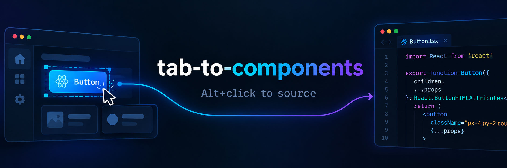

# tab-to-components — Chrome extension



A **Manifest V3 Chrome extension** that brings the
[tab-to-components](https://github.com/r48n34/tab-to-components) "Alt+click to
source" workflow to **any React development server**. Inspecting elements, the
overlay and every copy action need **no Vite config and no build plugin**.
**Open in IDE** is the exception: it is only offered when the page also runs the
tab-to-components Vite plugin, and the extension then delegates the launch to
that plugin's dev-server endpoint instead of opening `vscode://` URLs itself.

> This package is a port of the Vite plugin in
> [`packages/tab-to-components`](../tab-to-components). Both share the same
> overlay UX and the same copy actions; the extension works without touching
> the app's build, while the plugin additionally handles SSR frameworks and
> can launch any editor command on the dev-server machine.

## What you get

| Action | Result |
| --- | --- |
| Hold <kbd>Alt</kbd> + move the mouse | The element under the cursor is outlined; a label shows `<Component />` and `file:line:column`. |
| <kbd>Alt</kbd> + left click | Source action picker for the nearest component usage site: **Open in IDE** (when the Vite plugin is installed), **Copy file name**, **Copy full path**, **Copy relative path**, **Copy location**. |
| <kbd>Alt</kbd> + right click | Component chain picker listing every JSX ancestor of the clicked element. |
| After an action | A toast confirms the file opened or the text copied. |

Each picker row starts with the same small line icon as the Vite plugin's menu
— an arrow leaving a window for **Open in IDE**, a page for **Copy file name**,
a folder for **Copy relative path**, a drive for **Copy full path**, a pin for
the **file:line:column** location, and a stacked box for chain rows — so both
pickers stay visually identical.

The page's own click handler is suppressed only when the clicked element really
has React source information, and no overlay DOM exists until the modifier is
held.

## Requirements

- Chrome/Chromium **111+** (the MAIN-world agent is injected with
  `chrome.scripting.registerContentScripts({ world: "MAIN" })`; current Chrome
  releases are fine).
- A page served from **http(s)://localhost:…** or **127.0.0.1** / **[::1]**
  (match patterns ignore ports). Other hosts are deliberately not injected.
- **Development builds** of React 18 or 19. Production builds carry no source
  information.
- For **React 19**, the dev server must serve JavaScript **source maps** (Vite
  does this automatically; Vite 8 is verified). React 18 does not need them.
- For **Open in IDE**, the page must also run the
  `tab-to-components` Vite plugin with its browser client enabled (the plugin
  injects `globalThis.__TTC_CONFIG__` and serves the editor endpoint). Without
  the plugin the action is hidden; the copy actions keep working.

## Install (load unpacked)

```bash
pnpm install
pnpm --filter tab-to-components-extension build
```

Then in Chrome: `chrome://extensions` → enable **Developer mode** → **Load
unpacked** → select:

```
packages/tab-to-components-extension/build/chrome-mv3-prod
```

Reload the extension after rebuilding. For development with automatic rebuilds
run `pnpm --filter tab-to-components-extension dev` and load
`build/chrome-mv3-dev` instead.

## Usage

1. Start your React dev server (any framework: plain Vite, React Router, Remix
   with Vite, Astro islands, …).
2. Hold <kbd>Alt</kbd> and move the mouse over the page. The outline and label
   appear on React elements.
3. <kbd>Alt</kbd> + click opens the source action picker; <kbd>Alt</kbd> +
   right click lists the component chain.
4. While <kbd>Alt</kbd> is held, the crosshair ruler (when enabled) follows the
   pointer. Press <kbd>Z</kbd> to drop a measurement point; move and press it
   again to add the next one. Releasing <kbd>Alt</kbd> clears every point.
5. **Open in IDE** is shown when the page runs the tab-to-components Vite
   plugin. It asks the plugin's dev-server endpoint to open the location, so
   the editor launches on the machine that runs the dev server — no protocol
   prompt and no `vscode://` URL involved. Without the plugin the row is hidden;
   use the copy actions instead.

Keyboard: <kbd>↑</kbd>/<kbd>↓</kbd>, <kbd>Home</kbd>/<kbd>End</kbd>,
<kbd>Enter</kbd>/<kbd>Space</kbd>, <kbd>Esc</kbd> work in both pickers.

## Settings

Open the toolbar popup for quick controls, or the options page for everything.
Settings are stored in `chrome.storage.local` under `ttc:settings:v1` and apply
live to open tabs.

| Setting | Default | Meaning |
| --- | --- | --- |
| `enabled` | `true` | Master switch. |
| `disabledOrigins` | `[]` | Origins where the overlay is off. |
| `keyboard` | `["alt"]` | Modifier(s) that arm the inspector; all must be held. |
| `open` | `"component"` | What Alt+click targets: `component`, `element`, or `menu` (chain picker). |
| `clickActions` | `["open","copy-file","copy-full-path"]` | Rows in the action picker, in order. A single row runs immediately. `open` is hidden when the page does not run the Vite plugin. |
| `menu` | `true` | Enable the Alt+right-click chain picker. |
| `theme` | `"dark"` | Overlay theme (`dark` or `light`). |
| `crosshair` | `false` | Show the crosshair ruler while the `keyboard` modifier is held: `false`, `true`, `"both"`, `"x"` or `"y"`. |
| `crosshairUnit` | `["px"]` | Readout unit(s) for the ruler and measurement labels: `"px"`, `"cm"`, `"mm"`, `"in"`, `"rem"`, or an ordered list such as `["px", "cm"]`. |
| `crosshairLineColor` | theme | Optional CSS color for the ruler lines and coordinate/measurement pill backgrounds. |
| `crosshairTextColor` | theme | Optional CSS color for the ruler and measurement pill text. |
| `crosshairPointKey` | `"z"` | Key that drops a measurement point while the ruler is visible: one letter or digit, case-insensitive. |
| `settingsSource` | `"plugin"` | Which settings win when both are installed: `plugin` follows the plugin's overlay options and stays idle while its overlay is up; `extension` takes over with the extension's settings and hides the plugin's overlay. |
| `projectRoots` | `{}` | Origin → absolute project root, used by **Copy full path** when a location has no absolute path (e.g. Vite-plugin markers). |
| `debug` | `false` | Verbose console logging. |

### Crosshair

The crosshair is off by default; enable it under **Options → Appearance**. It
appears only while the configured `keyboard` modifier is held (default
<kbd>Alt</kbd>) and disappears on release, so it does not cover the page while
you are not inspecting. Press the point key (default <kbd>Z</kbd>) to drop a
measurement point at the pointer; each new point is joined to the previous point
only. Segment labels use every configured `crosshairUnit` (for example
`300px · 7.94cm`). Physical units use the CSS reference pixel (`1in = 96px`),
and `"rem"` follows the document root font size.

`crosshairLineColor` paints the guide lines and the pill backgrounds;
`crosshairTextColor` sets the pill text. When omitted, the overlay theme palette
is used. Releasing the modifier, scrolling, or blurring the window removes all
points and labels. The point key also matches the physical key code, so macOS
<kbd>Option</kbd>+<kbd>Z</kbd> still works when Option changes the produced
character.

### Copy actions

| Action | Clipboard content |
| --- | --- |
| `copy-file` | `MyBox.tsx` |
| `copy-path` | `app/components/MyBox.tsx` |
| `copy-full-path` | `D:/proj/app/components/MyBox.tsx` |
| `copy-location` | `app/components/MyBox.tsx:12:5` |

### Open in IDE

The extension no longer registers or launches editor URL schemes. When the page
runs the Vite plugin, the MAIN-world agent reads the plugin configuration
(`globalThis.__TTC_CONFIG__`: `base`, `editorEndpoint`, `root`) and sends a
same-origin request to the plugin's dev-server endpoint, for example:

```
/__ttc/open-in-editor?file=D%3A%2Fprojects%2Fapp%2Fsrc%2FApp.tsx%3A20%3A9
```

The plugin validates that the file exists inside its project root, rate-limits
launches and starts the editor configured through its `editor` option (default
`code`; `editor: "auto"` delegates to Vite's own `__open-in-editor`). Because
the launch happens on the dev-server machine, it also works when the editor is
installed in WSL or a container.

No IDE preset or custom URL template is needed. If the endpoint rejects a
request, the toast explains why (file outside the project root, refused origin,
rate limit, …).

## How it works

An extension cannot add props during the dev server's transform, so the
extension reads React's runtime metadata instead:

```
MAIN world (contents/agent.ts)              ISOLATED world (contents/inspector.ts)
┌──────────────────────────────┐            ┌──────────────────────────────────────┐
│ React fiber tree             │  events    │ overlay (shadow DOM, same UI as the  │
│ capture-phase listeners      │ ─────────▶ │ plugin)                              │
│ synchronous fiber walk       │            │ source resolution (3 layers)         │
│ click suppression            │ ◀───────── │ clipboard + plugin discovery        │
└──────────────────────────────┘  config    │ settings via chrome.storage          │
                                            └──────────────────────────────────────┘
```

Source locations are recovered per fiber, deepest layer first:

1. **Vite plugin markers** — if the app happens to use the published plugin,
   `memoizedProps["data-ttc"]` already carries the exact project-relative
   location (works even with the plugin's overlay disabled).
2. **React 18 `_debugSource`** — the compiler source object
   (`{ fileName, lineNumber, columnNumber }`), with an absolute path.
3. **React 19 `_debugStack` + source maps** — React 19 ignores the JSX source
   argument and instead captures a stack at element creation. The first
   application frame points at the compiled `_jsxDEV(...)` call; the dev
   server's source map (Vite inlines it in each module) maps that generated
   position back to the original JSX site.

Vite's dev source maps often carry only a server-relative `sources` entry and no
absolute `file` (Vite 7 and 8 on Windows do exactly that), so the map alone is
not enough to build an editor target. The extension therefore also recovers the
absolute path the bundler embedded in the transformed module
(`_jsxFileName`, the react-refresh `RefreshRuntime.register(...)` call, or
esbuild's `fileName`), derives the project root from it, and uses that root for
every other location on the page — including the Vite plugin's
project-relative `data-ttc` markers.

For **Open in IDE** the inspector sends a `path:line:column` target to the agent.
The agent prefers a recovered absolute path and otherwise joins the relative
path onto the plugin root, then fetches the plugin endpoint and reports the
result back; the inspector never touches a URL scheme.

The agent is injected into every frame; the inspector runs in the isolated
world so it can use `chrome.storage`, the clipboard and `chrome.runtime`.

### Safety model

- Only loopback origins are matched: `localhost`, `127.0.0.1`, `[::1]`
  (http and https). No `<all_urls>` and no network requests outside the page's
  own origin.
- The page is treated as untrusted: every agent payload is shape- and
  size-validated, paths are checked for traversal/control characters, plugin
  base/endpoint values and editor targets are validated and length-capped, and
  editor requests are same-origin only. The extension launches no URL schemes;
  the Vite plugin enforces project-root containment and rate limits.
- Source-map fetches are same-origin only, time out after 3 s, and are capped.
- No `eval`, no remote code, no telemetry.

## Differences from the Vite plugin

| | Extension | Vite plugin |
| --- | --- | --- |
| App changes | none | add plugin to Vite config |
| Location source | React runtime metadata (React 18) / dev source maps (React 19) | `data-ttc` attributes injected at transform time |
| Open in IDE | only when the page runs the plugin, delegated to its dev-server endpoint | dev server launches any editor command |
| Click actions | five built-in path/copy rows | the same five rows plus per-IDE actions, AI/share presets (`copy-ai-context`, `copy-mention`, `copy-markdown`, `copy-chain`) and team-defined `customActions` templates |
| Supported frameworks | any React dev server (Vite verified) | Vite-based frameworks, including SSR |
| SSR-safe markers | n/a | yes (`data-ttc` identical server/client) |
| Requires dev source maps | React 19 only | no |

The two can be used together. `settingsSource` decides which configuration wins:

- **`plugin`** (default): the extension follows the plugin's `keyboard`, `open`,
  `clickActions`, `menu`, `theme` and crosshair options, and stays idle while
  the plugin's own overlay is on the page. With the plugin installed as `overlay: false`
  (markers only), the extension renders its overlay using those plugin options.
- **`extension`**: the extension takes over — it hides the plugin's overlay and
  uses its own settings. **Open in IDE** still goes through the plugin either
  way.

Switch it on the options page under **Vite plugin → When both are installed**
(the toolbar popup does not offer it; its **Open settings** button opens that
page). The popup's modifier select always edits the extension's stored
settings; those only apply while the extension is the settings source (or on
pages without the plugin).

## Troubleshooting

**"Nothing happens" on an app that also uses the Vite plugin.**
The popup says *"Vite plugin overlay active (idle)"*. That is the default
(`settingsSource: "plugin"`): the extension yields to the plugin's overlay. To
use the extension UI instead (both delegate Open in IDE to the plugin):

- choose **Use the extension settings** under **Options → Vite plugin**, or
- set `overlay: false` in the plugin options (`tabToComponents({ overlay:
  false })`) so only the extension provides the UI.

If the plugin's editor launch cannot work on the dev machine (for example a dev
server running in Docker/WSL), use the copy actions.

**Nothing happens.**
The page must be a loopback dev server (`localhost`, `127.0.0.1`, `[::1]`) and a
**development** React build. Reload the page after installing/reloading the
extension so the agent registers. The popup shows whether React and the
inspector were detected.

**"No source location available" on React 19.**
The dev server did not serve a source map for that module, or React's owner
stack capture was rate-limited (React captures real stacks for 10k elements per
second; it resets after ~1s). Hover again after a moment. Vite always serves
maps; React 18 is unaffected.

**The label shows an absolute path instead of a project-relative one.**
React 18 has no project-relative path in its metadata. Set a project root for
that origin in the options page, or use the Vite plugin's markers.

**"Open in IDE" is missing.**
The page does not run the tab-to-components Vite plugin, or its browser client
is disabled (`includeClient: false` / production build). The extension hides the
action instead of launching an editor URL; the copy actions still work. Add the
plugin to `vite.config.ts` and reload the page — the popup shows *"Vite plugin
connected"* when the config was found.

**"Open in IDE" fails with a message.**
The toast reports what the plugin endpoint answered: the file must exist inside
the plugin's project root (400), the request origin must be allowed (403, check
the plugin's `origin`/`editor` options), and repeated launches are rate-limited
(HTTP 429). The editor chosen by the plugin's `editor` option must be installed
on the machine that runs the dev server; check the Vite terminal for the
plugin's launch error.

**Two overlays appear.**
The Vite plugin's overlay was detected late. Reload the page, or disable the
plugin's overlay (`overlay: false`) and keep the extension UI.

**A React Router/Remix/Astro app shows no source for some files.**
Only JSX/TSX modules instrumented by the dev server are visible. `.astro`
markup, MDX output and precompiled dependencies are not.

## Limitations

- Chrome MV3 only; Firefox/Safari and the Chrome Web Store are not covered.
- Loopback origins only. LAN IPs, custom dev hostnames and HTTPS with
  self-signed certificates are not injected.
- React 19 depends on development source maps; production builds, minified
  bundles and HMR-disabled servers may not resolve.
- Non-Vite dev servers (webpack, Next.js) are best effort and not verified.
- Open in IDE requires the tab-to-components Vite plugin on the page; without
  it the extension can only copy paths. There is no native companion that runs
  editor commands.
- `array.map()` rows open the JSX inside the callback (the only location in the
  source), exactly like the plugin.

## Development

```bash
# from the repo root
pnpm --filter tab-to-components-extension dev        # Plasmo dev build + reload
pnpm --filter tab-to-components-extension build      # production MV3 build
pnpm --filter tab-to-components-extension typecheck  # tsc --noEmit
pnpm --filter tab-to-components-extension test       # vitest
node packages/tab-to-components-extension/scripts/verify-build.mjs
```

This repo is developed in a locked-down Windows sandbox where Vite's config
loader shells out (`net use`) and fails with `spawn EPERM`. Run test/typecheck
commands with the repo shim when you hit that:

```powershell
$node = 'C:\Users\devre\.dsh\dsh-runtimes\dsh-primary-runtime\dependencies\node\bin\node.exe'
$shim = 'file:///D:/Github/tab-to-components/scripts/sandbox-shim.mjs'
cd packages/tab-to-components-extension
& $node --import $shim ../../node_modules/vitest/vitest.mjs run
```

The production build works in the sandbox without the shim (Plasmo/Parcel uses
worker threads).

### Tests

- `test/source/*` — path safety, stack parsing, React 18 source objects, real
  Vite source-map fixtures (`test/fixtures/vite-react19-module.ts` and
  `test/fixtures/vite-react19-no-map-file.ts`), layered resolution.
- `test/agent/*` — fiber discovery/naming, chain walk, modifier handling.
- `test/install.test.ts` — happy-dom integration of the overlay controller
  (hover label, action/chain menus, copy/open flows, crosshair pointers and
  measurement points, hiding Open in IDE without a plugin, protocol messages).
- `test/ui/overlay.test.ts` — overlay DOM/CSS/keyboard contract.
- `test/plugin-editor.test.ts`, `test/settings.test.ts`,
  `test/protocol.test.ts`, `test/actions.test.ts`, `test/chain.test.ts`,
  `test/clipboard.test.ts`, `test/content-config.test.ts` — plugin config
  parsing/validation, editor targets and endpoint URLs, settings, protocol
  messages (including editor requests/results), helpers and static
  content-script config.

The fixtures are generated from `playground/vite-react/src/App.tsx` through
Vite 8 + `@vitejs/plugin-react` 6; their expected positions
(`src/App.tsx:9:5`, `10:7`, `20:9`) are exactly the markers the Vite plugin
injects, which is the parity guarantee for the React 19 source-map path.
`vite-react19-module.ts` keeps a hand-canonicalized absolute `file` in the map;
`vite-react19-no-map-file.ts` matches what Vite 7/8 actually serve in dev — no
`file`, relative `sources` — so the absolute path can only come from the
transformed code (`_jsxFileName` / `RefreshRuntime.register`).

### Manual QA checklist (Chrome)

1. Build and load `build/chrome-mv3-prod` unpacked.
2. Start `pnpm --dir playground/vite-react dev:ext` (the same app **without**
   the Vite plugin) and open the printed URL.
3. Alt+hover the button → `<Button /> src/App.tsx:20:9`; Alt+click → picker;
   each copy action writes the exact text; Alt+right-click lists
   `<button /> → <Button /> → <FeatureCard /> → <App />`.
4. Alt+click the button → picker shows **Copy file name / Copy full path**
   only (no Vite plugin on this page), and no "Open in IDE" row appears.
5. HMR edit `App.tsx`, save, hover again → updated line.
6. Repeat with React 18:
   `pnpm --dir compat/react18/apps/vite exec vite --config vite.ext.config.ts`.
7. Run `pnpm --dir playground/vite-react dev` (plugin enabled) → the extension
   stays idle and the plugin's overlay handles Alt+click. Choose **Use the
   extension settings** under **Options → Vite plugin**: the extension takes
   over, the picker includes **Open in IDE**, and selecting it opens the file in
   the editor configured by the plugin (check the Vite terminal for the launch
   line) without any Chrome protocol prompt. Switch back to **Use the plugin
   settings** → the extension idles again and its keyboard/open/theme follow the
   plugin.
8. Non-React page on localhost → no overlay, Alt+click is not suppressed.
9. Production site (not localhost) → extension is not injected at all.

## License

MIT © Reemo studio
